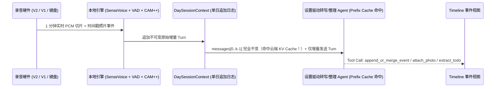

# 全天连续单上下文（Full-Day Single-Context）与设置驱动转写 Agent 规划

> 状态：架构与配置模型定稿（2026-11-11）
> 范围说明：按阶段约束，**本次仅落盘规划文档 + 完成「设置驱动基础设施（模型 / 提示词 / 预设风格 / Skills / Tools / MCP）」及手动总结接入**，暂不改动自动润色与切片自动合并管线代码；待本轮多硬件与设置体系真机稳定后按本方案实施。

---

## 1. 核心洞察：为什么「滑动窗口重复发上下文」是错误的？

在旧方案（`handoff-2026-11-08-asr-polish-plan.md`）中，自动润色与话题分段采用「每攒够 N 片就截取前文 K 片 + 当前片拼成新请求发送给大模型」的滑动窗口方式。这种方式在 **Always-On 全天录音** 场景下存在三大结构性缺陷：

1. **上下文碎片化**：下午 16:00 提到的「按上午张总定的第二个预算方案走」，滑动窗口早已丢掉上午 10:00 的记录，模型既无法消解指代，也无法把跨时段的同一议题聚合。
2. **前缀 KV Cache 100% 失效、Token 重复计费**：每次滑动窗口截掉头部旧内容，Prompt 前缀发生变化，云端网关（OpenAI / DeepSeek / Anthropic / Gemini 兼容前缀缓存）无法命中 Prefix KV Cache，导致同样的历史文本一天内被重复计费数十次。
3. **硬编码流水线束缚了用户场景**：法务访谈、产品评审、课堂笔记、个人随想对「如何清洗口语、按什么粒度合并事件、提炼什么产物」的需求截然不同，不应写死在代码里的固定两步流水线，而应**由设置驱动（Model + Prompt + Preset + Skills + Tools + MCP）交给统一的日级 Agent 自主编排**。

---

## 2. 全天单上下文架构（Append-Only `DaySessionContext`）

### 2.1 一天一个不可变前缀会话（KV Cache 友好设计）

将每一自然日（以「做梦卡」夜间 >5h 空白切日为准，默认凌晨 `04:00` 切日边界）建模为一个**只追加（Append-Only）的多轮 Agent 会话 `DaySession`**：



### 2.2 严格的 Prefix Cache 命中不变量

为了保证云端模型网关对前序上下文达到 **90%+ 的 Prefix Cache 命中率**，`DaySessionContext` 严格遵守以下四条不变量：

1. **System Prompt 与 Tool 定义日内冻结**：
   - `messages[0]`（System Prompt = 角色基座 + 当前预设风格指令 + 已启用 Skills 注入块）与 `tools` JSON Schema 在同一会话轮次内保持字节级稳定；用户在设置页修改提示词/模型后，平滑切分新会话代次（`sessionEpoch + 1`）并携带前序精简摘要续接。
2. **历史 User/Assistant 消息零改写（严禁原地修改旧 Turn）**：
   - 每当本地 SenseVoice 产出一批新切片（例如攒够 3~5 分钟有效语音，或检测到 >90 秒静音自然停顿，或用户手动打开 App 查看），作为**全新的 `user` 增量消息**追加到会话末尾：
     ```json
     {
       "role": "user",
       "content": "[INCREMENT 14:05:00-14:08:00 | slices: live_21..live_23 | device: card_v2]\n[14:05:12][说话人 1(推测)] ...\n[PHOTO 14:06:30 photo_id=img_004 source=dyj_v1]"
     }
     ```
   - 绝不去修改 `messages[1..2k-1]` 中已经发过的文本，哪怕前一段识别有错字，也通过 Agent 输出增量修正指令（`patch_event`）更新本地视图，从而保证前缀 Token 序列 100% 恒定。
3. **增量输出走结构化增量指令（Delta Operations），而非全量重写全文**：
   - Agent 每次只针对最新增量返回轻量 Tool Call，输出 Token 极少、响应极快：
     - `merge_into_active_event(event_id, cleaned_paragraphs, updated_title?, summary_preview_3_lines)`：同一场持续 1~2 小时的会议，持续归并进同一条 Timeline 记录卡，外侧简介始终保持精炼 3~5 行。
     - `start_new_event(title, start_ms, cleaned_paragraphs, tags)`：话题显著切换或长时间静默后开启新事件卡。
     - `triage_photo(photo_id, event_id | "unclassified", caption?)`：结合前后文判断期间拍摄的照片是否属于本场对话。
     - `emit_action_item(text, due_hint?, source_slice_id, offset_ms)`：实时沉淀待办并保留精确到毫秒的原始录音溯源锚点。
4. **跨超长全天（>128k Tokens）的分层锚点压缩**：
   - 一整天 8 小时高密度说话约 `60k ~ 90k` 中文字符（约 `50k ~ 80k` Tokens），主流 128k/200k/1M 上下文模型均可单会话完整容纳。
   - 若极端高强度超过阈值（如 `100k` Tokens），触发一次「章节归档检查点（Checkpoint）」：将已完结的上午事件折叠为结构化事件大纲（保留 `event_id`、人物、关键结论与时间范围），开启下午子段会话，夜间「做梦（Dreaming）」阶段再统一做全天记忆清洗、知识库归档与个人技能提炼。

---

## 3. 设置驱动的 Agent 能力体系（本次已在设置页与存储层先行落地）

将原本写死在代码里的 AI 逻辑彻底外化为用户可控、可预设、可扩展的四大配置域（初期开放完整专业选项便于调优验证，后续打磨出黄金预设后再对普通用户做渐进式收纳）：

### 3.1 本地语音引擎配置（`LocalEngineConfig`）
统一收纳三大端侧离线模型（明确各自职责，消除概念困惑）：
1. **离线语音转写（SenseVoice Small INT8）**：负责把 16kHz WAV 切片离线转成中文/中英混排原始文本，零音频上云。
2. **语音活动检测（Silero VAD）**：切掉长时间空白与环境底噪，既是本地切片有效语音判据，也是未来触发云端增量整理（静默边界触发）的信号源。
3. **声纹特征聚类（3D-Speaker CAM++）**：提取每句语音声纹向量做本机聚类，标注「说话人 1 / 2（推测）」，绝不断言真实姓名。

### 3.2 云端模型设置（`CloudModelConfig`）
- **模型选择**：动态拉取模型网关 `/api/model-gateway/v1/models` 可用列表，支持分别或统一指定「日常流式整理模型（低延迟高缓存命中）」与「深度总结 / 做梦模型（强推理）」。
- **上下文模式**：
  - `full_day_cached`（推荐，规划目标）：全天连续单上下文（命中 Prefix KV Cache，跨时段指代消解）。
  - `scoped_selection`（当前手动总结已生效）：仅发送勾选记录范围的独立上下文。
- **采样温度（Temperature）**：纪要整理默认低温度（`0.2`）防幻觉，头脑风暴预设可调高。

### 3.3 Agent 预设风格与提示词（`AgentPreset & Prompts`）
提供一键切换的预设风格胶囊，同时允许展开二级编辑器逐项微调并持久化（支持一键恢复默认）：
1. **通用纪要（默认）**：平衡背景、核心结论、结构化信息点与行动项，适合日常混合办公。
2. **深度会议**：强化议题分歧、各方观点对照、决策依据与明确责任人/截止时间。
3. **访谈提炼**：保留受访者金句原话与情绪语气，按问题脉络提炼洞察与证据锚点。
4. **极简待办**：极致压缩寒暄与过程讨论，只保留 3 行结论摘要与可执行 Checklists。
5. **自定义风格**：用户完全自主编写三段核心提示词：
   - **总结生成提示词（`summarySystemPrompt`）**：本次已直接接线至 `SummaryGenerator`，修改后立即影响总结生成结果！
   - **口语清洗与分段提示词（`polishSystemPrompt`）**：供下一阶段 `DaySession` 增量合并切片与清洗口语使用。
   - **日终日报与夜间做梦提示词（`dreamSystemPrompt`）**：定义每日日终复盘与夜间记忆归档规则。

### 3.4 扩展能力：Skills · Tools · MCP（`AgentExtensionsConfig`）
- **Skills（领域技能包）**：可勾选叠加的模块化指令与输出模板（如「术语纠错与中英专有名词保留」、「三行极简卡片简介约束」、「发言立场与待确认风险标注」及用户自定义 Skill）。启用的 Skill 自动拼入 Agent 的冻结 System Prompt。
- **Tools（本机原生工具授权）**：
  - `photo_time_align`：允许对齐录音时间窗内的点一机抓拍与系统相册照片；
  - `timeline_backlink`：允许检索历史日期事件辅助消解人名/项目名；
  - `action_extractor`：结构化抽取行动项并绑定原始音频毫秒偏移。
- **MCP Servers（外部模型上下文协议）**：
  - 支持配置远端 HTTP/SSE MCP Server（名称、Endpoint、鉴权 Header、启停开关），为后续把每日总结与行动项自动同步至飞书文档、Notion、Linear 或个人知识库预留标准通道。

---

## 4. 下一阶段实施路线图（待本轮验收合并后推进）

1. **Phase A（已完成，见本 PR）**：完成 `AgentConfigStore` 持久化模型、设置二级页 UI（HTML 设计稿 + Flutter 双端对齐），并将「云端模型选择 + 预设风格 + 自定义总结提示词 + 启用 Skills」实时接入手动总结生成器 `SummaryGenerator`。
2. **Phase B（DaySession 存储与增量调度器）**：新增 `DaySessionStore`，持久化当日已发送 `turn_index`、冻结 `system_prompt_hash` 与活跃 `RecordEvent` 聚合映射表；当静默超过 90 秒或累计满 5 分钟新转写切片时，以 Append-Only 方式调用 `/chat/completions` 触发增量合并。
3. **Phase C（三层展示无损溯源）**：合并后的长会议在 Timeline 展示为单张事件卡（3~5 行清洗简介 + 关联照片叠层），点进「对话详情」看清洗分段与内嵌照片，点进「原始数据」仍可按 1 分钟原始切片逐句点按快进回听。
