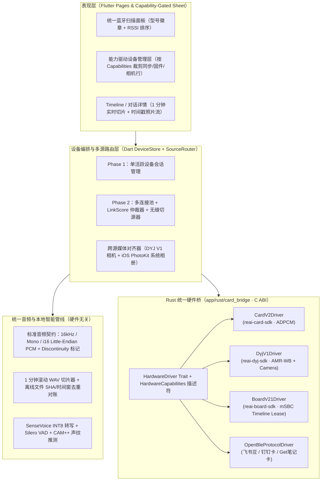

# 多硬件录音设备解耦与无缝多源切换架构设计

> 状态：Phase 1（统一抽象层 + 自研三款设备单连接落地）已实施；第三方独立 SDK 包装层（`reai-ext-sdk` + `reai-getseed-sdk` + `reai-omi-sdk` + `reai-feishu-sdk`）已落地。飞书录音豆当前包只覆盖 BLE 文件同步，SoftAP 与 OTA 未纳入；Priority 3（Plaud Note / Pro）待独立分支推进；Phase 2（多设备并发连接与无缝切源）架构定稿
> 更新日期：2026-11-18

---

## 1. 设计目标与产品定位

本客户端定位为 **Always-On 全天候个人语音记忆终端的最优解**。硬件不应成为业务层（时间轴、本地 ASR、声纹聚类、相册对齐、Agent 总结）的耦合点：

1. **自研三款硬件全量接入（今晚 Phase 1 落地，单活跃连接）**：
   - **录音卡 V2**（`reai-card-sdk` v0.0.6，广播前缀 `DYJV2_`）：nRF + ESP32 双芯，IMA-ADPCM 实时流 + SD 卡 `.APM` 离线存储 + 两阶段固件 OTA。
   - **点一机 V1**（`reai-dyj-sdk` v0.1.14，广播前缀 `DYJ_`）：Android 智能硬件，AMR-WB 12.65kbps 实时流 + `.amr` 落盘 + 物理按键拍照/录像（`files/camera`）+ SoftAP 8788 快传与远端同步。
   - **语音 AI 键盘 V2.1**（`reai-board-sdk` v0.3.5，广播前缀 `REAI_VB_`）：桌面/移动常开蓝牙麦克风键盘，Vendor GATT（`0xFE60`）mSBC 16kHz 实时流（`AudioStreamScope::Timeline` 租约续期）+ 物理 AI 语音键事件（`AiVoiceKey`），**无板载存储**。
2. **第三方开源蓝牙录音硬件平滑扩展（Phase 2 插件化）**：
   - **飞书录音豆**、**钉钉录音卡（DingTalk Card）**、**得到 Get 笔记录音卡** 等公开 BLE GATT 协议设备，只需实现统一 `HardwareDriver` 适配器，无需改动上层切片器、ASR 管线与 UI 状态机。
3. **多设备并发作为协同数据源（Phase 2 多源融合）**：
   - 桌面办公用「语音 AI 键盘 V2.1」常开供电收音；起身离开工位自动无缝切到随身佩戴的「录音卡 V2 / 点一机 V1」；会议拍照由「点一机 V1」或「手机系统相册」按时间戳自动对齐插入同一条对话流。

---

## 2. 核心解耦分层（四层架构）

---

## 3. 硬件能力矩阵与统一协议契约

UI 与同步调度器**严禁写 `if (deviceKind == 'board_v21')` 之类的型号硬编码判断**，一律读取设备连接时声明的 `HardwareCapabilities` 能力位进行裁剪：

| 能力字段 (`HardwareCapabilities`) | 录音卡 V2 (`card_v2`) | 点一机 V1 (`dyj_v1`) | 语音 AI 键盘 V2.1 (`board_v21`) | 第三方硬件（按型号声明） | UI / 业务层行为映射 |
|---|---|---|---|---|---|
| `blePrefix` / 广播识别 | `DYJV2_*` | `DYJ_*`（排除 `DYJV2_`） | `REAI_VB_*`（含系统已配对 GATT） | Service UUID + 厂商广播头 | 统一扫描面板自动识别型号徽章 |
| `realtimePcm16k`（实时流） | ✅ IMA-ADPCM → 16k PCM | ✅ AMR-WB 12.65k → 16k PCM | ✅ mSBC (`FE63`) → 16k PCM | ✅ Opus / ADPCM / mSBC → 16k PCM | 开启录音即走 1 分钟本地流式切片 + SenseVoice 转写 |
| `hasOnboardStorage`（板载落盘） | ✅ SD 卡 `.APM` | ✅ `/data` 分区 `.amr` | ❌ 无存储（纯流式麦克风） | 视具体型号声明 `true/false` | `false` 时隐藏「剩余可录空间估算」与离线补传提示 |
| `hasFileSync`（离线文件回补） | ✅ BLE 分块下载 | ✅ SoftAP 8788 / Server 回拉 | ❌ 不支持 | ✅ BLE / Wi-Fi 快传 | `false` 时设备弹层隐藏「同步」行，停止录音不触发文件拉取 |
| `hasCameraMedia`（硬件拍照/媒体） | ❌ | ✅ 物理键抓拍 `img_*.jpg` | ❌ | 部分支持 | `true` 时监听相机事件并拉取照片按时间戳归入当前对话 |
| `hasPhysicalRecordToggle` | ✅ 拨杆 + 按键打点 | ✅ 单击/双击/长按手势事件 | ✅ 物理 AI 语音键 (`AiVoiceKey`) | Get笔记卡 ✅ / Omi ✅ / 其他视型号 | 硬件侧操作经 `events.pull` 1s 内同步翻转 App 录音开关 |
| `hasRemoteRecordControl` | ✅ 远程启停 | ✅ 远程启停 | ✅ 远程启停 | Get笔记卡 ❌（仅机身控录）/ Omi ✅ | `false` 时 `StatusSheet` 隐藏 `rec-toggle`，展示「机身按键控录」 |
| `hasWifiConfig`（设备配网） | ✅ 2.4GHz Wi-Fi 配置 | ✅ Wi-Fi 扫描/连接/忘记 | ❌ 不需要 | ❌（Round 1 经 BLE 同步） | `false` 时设备弹层隐藏「Wi-Fi 网络」行 |
| `otaMode`（固件升级形态） | `dual_chip`（主控 DFU + ESP32） | `single_ota`（清单检查/安装） | `usb_only`（移动端隐藏） | `none`（官方 App 升级） | `none`/`usb_only` 时移动端设备弹层隐藏「固件更新」行 |

### 3.1 统一实时音频流契约（Rust → Dart）

所有硬件驱动在 Rust 层完成各自的帧重组、丢包检测与编解码器状态维护（IMA-ADPCM / vendored `opencore-amrwb` / `msbc-decoder`），向 Dart 层只输出唯一标准格式：

- **采样率**：`16,000 Hz`
- **声道数**：`1`（单声道）
- **样本格式**：`i16` Little-Endian（Base64 批量帧回调）
- **断裂信号（`state: "gap"`）**：无论是 BLE 通知序号跳变（V1 `seq_le` / V2 分块 / 键盘 `SequenceTracker`）还是解码丢帧，统一向 Dart 发送 `gap` 进度帧，记录该切片存在物理链路丢包，供后续离线文件对账决定是否需要补齐。

### 3.2 统一事件语义（`events.pull` 零蓝牙开销本地队列）

各硬件 SDK 的异构推送事件在 `card_bridge` 内统一归一为标准语义事件：

- `{"kind": "record", "status": {"recording": bool, ...}}`：硬件主动开始/停止录音或分段滚动（`record.segment`）。
- `{"kind": "power", "power": {"charging": bool, "level": u8?}}`：插入/拔出充电线、电量变化（键盘 `DeviceInfo`、卡片 `PowerEvent`）。
- `{"kind": "voice_key", "pressed": bool}`：键盘物理 AI 语音键或点一机手势键触发录音切换。
- `{"kind": "camera", "event": ...}`：点一机硬件按键拍照完成事件，通知 App 记录照片锚点并在合适通道同步原图。

---

## 4. 第三方蓝牙录音设备 ReAI 风格独立 SDK 包装规范

为避免上层 `card_bridge` / Flutter `DeviceStore` 与具体厂商私有字节协议耦合，所有第三方设备均采用 **Per-Device ReAI SDK Crate + 统一契约 Crate** 的分层方案，位于 `app/rust/sdks/`：

- **`app/rust/sdks/reai-ext-sdk`（公共契约层）**：定义 `RecorderDriver` / `RecorderDevice` 异步 trait、`HardwareCapabilities`（含 `hasRemoteRecordControl`）、`DeviceSnapshot`、`DeviceFile`、`RealtimePcmChunk`、`DeviceEvent` 以及统一 Ogg Opus / Raw Opus / LC3 / WAV → `16kHz / i16 / Mono PCM` 纯 Rust 转码（`opus-pure` + `lc3-codec`，无 C/CMake 依赖，确保 iOS `aarch64-apple-ios` 静态库零障碍编译）。
- **Round 1 已落地（默认关闭，需在 Setting →「硬件设备联动 → 第三方硬件联动」按需启用，保持默认 3 款自研扫描基线不变）**：
  - **`app/rust/sdks/reai-getseed-sdk`**（得到 Get 笔记录音卡 / GetSeed GSC10，`deviceKind: "getseed_gsc10"`）：厂商广播过滤（Company ID `0x544A` / `Get-*`）、GATT `0xFF00` TLV 命令帧、Ogg Opus / WAV 离线文件拉取、只删单文件（`0x0044`；严禁调用 `0x0041` 全盘擦除）、`hasRemoteRecordControl = false`（UI 裁剪为「机身按键控录」）。
  - **`app/rust/sdks/reai-omi-sdk`**（Omi 量产版 CV1 / Friend Pendant，`deviceKind: "omi_cv1"`）：UUID-only / `Omi-*` / `Friend_*` 广播识别、Opus / PCM / μ-law / LC3 实时分片重组（`19B10000` 服务）、按键手势特征（`23BA7924` → `voice_key` / `mark`）、StorageRing（`30295780`）离线文件下载与单文件清理、标准 BAS（`0x2A19`）电量读取。
  - **`app/rust/sdks/reai-feishu-sdk`**（飞书录音豆 / soundcore Work D3200，`deviceKind: "feishu_d3200"`）：服务 `020cf5da-0000-1000-8000-00805f9b34fb` 或名称 `D3200-*` / `soundcore Work` 识别。本包实现设备信息、时间同步、远程启停、分页目录、ECDH P-256 会话密钥与 AES-CTR 离线 Opus 拉取，再封装 Ogg 并转 16kHz WAV。`realtime_audio = false`，`has_wifi_config = false`，`ota_mode = none`。SoftAP 快传与固件升级仍走官方 App。
- **后续独立分支规划**：
  - Priority 3：Plaud Note / Pro（`reai-plaud-sdk`）

1. **广播指纹注册（`ScanMatcher`）**：
   - 支持按 `local_name` 前缀、Manufacturer Data（Company ID）或 16/128-bit Service UUID 匹配，不污染其他设备的扫描过滤。
2. **纯 Rust 音频解码器适配（`reai-ext-sdk::audio`）**：
   - 自研硬件使用 `IMA-ADPCM` / `AMR-WB` / `mSBC`；第三方 SDK 在包内或 `reai-ext-sdk` 完成 **Ogg Opus / Raw Opus / LC3 / μ-law → 16kHz Mono PCM / WAV** 解码，零改动接入现有 1 分钟本地切片与 SenseVoice 转写管线。
3. **控制面最小子集实现（`RecorderDriver` / `RecorderDevice`）**：
   - 必选：`connect`、`disconnect`、`snapshot`、`battery_snapshot`、`open_realtime`、`close_realtime`。
   - 可选（按 `HardwareCapabilities` 声明）：`start_record`/`stop_record`（仅 `hasRemoteRecordControl == true` 暴露远程开关）、`list_files`、`download_file`、`delete_file`、`sync_time`。
4. **离线切片与实时切片对账（`TimeWindowReconciler`）**：
   - 统一按 `[recordingStartEpochMs, recordingEndEpochMs]` 时间区间对账：若某段录音期间实时流 `gaps == 0` 且已落盘完整 16kHz WAV，离线同步自动跳过该文件，避免重复蓝牙拉取耗电；若实时流期间发生断连或高丢包（`gaps > threshold`），才回补对应时间窗的板载录音文件。

---

## 5. Phase 2：多设备并发连接与无缝切源设计（Near-Me Source Arbitration）

当前版本（Phase 1）已完成统一扫描与单活跃设备连接；Phase 2 将 `BridgeState.device: Option<ActiveDevice>` 升级为连接池 `HashMap<DeviceId, ActiveDeviceSession>`，实现多设备同时在线与智能选源。

### 5.1 为什么多设备是 Always-On 的终极形态？

| 场景 | 在线设备组合 | 期望协同行为 |
|---|---|---|
| 工位办公 | 语音 AI 键盘 V2.1（USB 供电常开）+ 胸牌录音卡 V2 | 键盘距离嘴更近、供电无限、双麦阵列信噪比更高 → **主选键盘流**，录音卡待机省电 |
| 起身去会议室 / 走廊交谈 | 键盘信号衰减（RSSI 从 `-52 dBm` 跌至 `-85 dBm` 或断连），胸牌录音卡 V2 稳定 `-58 dBm` | **2 秒平滑交叉切换**至录音卡 V2 实时流，同一条会议上下文不断流 |
| 白板讨论抓拍 | 录音卡 V2 录音中 + 点一机 V1 按键拍白板（或 iPhone 系统相机拍照） | 音频取自录音卡 V2，照片取自点一机 V1 / 系统相册，按毫秒级墙钟对齐进同一场对话详情 |

### 5.2 链路质量评分（`LinkQualityScore`）与防抖切换算法

为每个已连接设备维护 5 秒滑动窗口评分 $S_i \in [0, 100]$：

$$S_i = 0.45 \cdot f_{\text{RSSI}}(\overline{\text{RSSI}}_i) + 0.35 \cdot (1 - \text{PacketLossRate}_i) \cdot 100 + 0.20 \cdot \text{PowerBonus}_i$$

- $f_{\text{RSSI}}$：`-50 dBm` 以上满分 `100`，`-90 dBm` 为 `0`，使用指数移动平均（EMA，$\alpha = 0.3$）滤除人体遮挡瞬时波动。
- $\text{PacketLossRate}_i$：过去 5 秒实时音频帧序号缺失率（断连记为 `1.0`）。
- $\text{PowerBonus}_i$：外接电源/充电中设备（如桌面键盘）赋 `100`，高电量随身设备赋 `60`，低电量（`<20%`）降权为 `10` 以保护续航。

**无缝切源迟滞准则（Hysteresis，严防乒乓切换）**：
1. **主动切源条件**：候选设备 $B$ 的评分连续 **4 秒** 高于当前主源 $A$ 超过 **18 分**（$S_B - S_A > 18$），或主源 $A$ 连续 **1.5 秒** 无音频包到达（突发断连）。
2. **先建后断（Make-Before-Break）**：
   - 先打开设备 $B$ 的实时流（`B.realtime.open`），等待首包有效 PCM 到达；
   - 在 200ms 重叠窗口内按能量包络对齐拼接点（零交叉点切入），再关闭设备 $A$ 的实时流（`A.realtime.close`），实现无空洞切换；
   - 每个切片元数据记录 `sourceSegments: [{deviceId, deviceKind, offsetMs, endMs}]`，原始数据页如实展示声音来源轨迹。
3. **交叉补盲（Cross-Device Gap Healing）**：
   - 若设备 $A$ 在切换前 3 秒出现蓝牙丢包（`gap`），而设备 $B$（如录音卡 V2 / 点一机 V1）开启了板载落盘，后续空闲同步时仅截取缺失时间窗重跑本地 SenseVoice，自动修补缺字。
