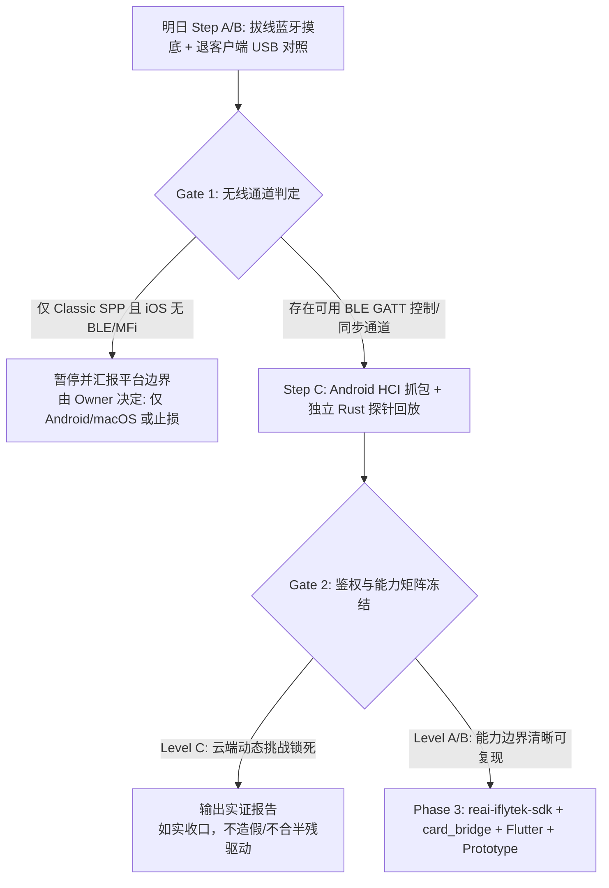

# 讯飞智能录音笔 A1 · Phase 1 连线态实测评估与续测方案（2026-11-22）

- **状态**：Phase 1 连线态摸底完成；只读诊断探针与 `btsnoop_hci.log` 解析工具已落地并自测通过（**本分支仅包含调研工具与评估文档，不含任何业务代码修改，暂不合并**）。
- **基线提交**：`master @ 52eb2c8`
- **目标硬件**：讯飞智能录音笔 A1（主控：炬芯 Actions ATS2837 双模蓝牙 SoC；历史现场已目击 BLE 广播名 `讯飞录音笔A1_11E0`，详见 [handoff-2026-11-16-omi-android-ble-e2e.md](handoff-2026-11-16-omi-android-ble-e2e.md)）
- **协作对齐原则（Owner 已确认，2026-11-22）**：
  1. 当前暂无 Android 测试机与独立离线环境，次日补齐实体测试条件后继续推进；
  2. 先完成 USB 与蓝牙全面评估，摸清真实能力与平台边界（iOS / Android / macOS）后再决策接入范围；
  3. 当前 USB 连线态与蓝牙无线态均纳入检测；
  4. 待协议与能力矩阵冻结进入 Phase 3 开发时，同步更新 `prototype/current.html`、`prototype/index.html` 与 `prototype/verify.cjs`。

---

## 一、Phase 1 连线态实测证据（2026-11-22 01:15~01:26 CST）

### 1.1 宿主环境
- **宿主机**：macOS（蓝牙控制器 `BCM_4364B0`，`Address: 38:F9:D3:51:2D:6E`，`State: On`，固件 `v122 c4439`，支持 `HFP AVRCP A2DP HID Braille LEA AACP GATT SerialPort`）。
- **物理连接状态**：讯飞录音笔 A1 通过 Type-C 数据线接入 Mac 下游 USB 2.1 Hub，且本机「讯飞听见」桌面客户端（Electron `9.4.4` / `v3.0.2249`）正在运行。

### 1.2 USB 总线与存储枚举实测

通过 `system_profiler SPUSBDataType`、`ioreg -r -n "CDC ACM" -l`、`diskutil list external`、`ls -la /Volumes/` 与 `lsof` 取得只读总线状态：

| 检测项 | 实测值 | 说明 |
|---|---|---|
| 上游链路 | `USB2.1 Hub` (`0x0bda:0x5411`, `PortNum=3`) → `Location ID: 0x14130000 / 47` | USB 2.0 High-Speed（480 Mb/s） |
| 厂商 / 设备标识 | `Vendor ID: 0x10d7` (`Actions`) / `Product ID: 0xb00a` | 炬芯半导体 USB VID/PID |
| 设备描述符 | `Product Name: "CDC ACM"`, `Serial Number: "00.01"`, `bcdUSB: 0x0200`, `bcdDevice: 0.00`, `bDeviceClass: 2` | 通信设备类（非复合 MSC 设备） |
| 供电参数 | `Bus Power Available: 500 mA`, `Current Required: 100 mA` | 正常枚举供电 |
| USB Interface 0 | `bInterfaceClass=2, SubClass=2, Protocol=1, Endpoints=1` (`AppleUSBACMControl`) | CDC ACM 控制接口 |
| USB Interface 1 | `bInterfaceClass=10, SubClass=0, Protocol=0, Endpoints=2` (`AppleUSBACMData`) | CDC ACM 数据接口 |
| 串口节点 | `/dev/cu.usbmodem00_011` 与 `/dev/tty.usbmodem00_011` | 由 `IOSerialBSDClient` 注册 |
| 外部磁盘 / MSC | `/Volumes/` 仅见 `Macintosh HD`；`diskutil list external` 为空 | **当前未暴露 U 盘（MSC）接口** |
| 宿主进程占用 | `lsof` 显示 PID `59072`（`讯飞听见`）持有 `/dev/tty.usbmodem00_011`（`FD 65u`）；`ioreg` 见 `AppleUSBHostDeviceUserClient` | 串口当前被官方桌面端独占通信 |

### 1.3 蓝牙射频扫描实测（USB 连线态）

在保持上述 USB 连接的状态下，分别运行 `card_bridge` `raw_scan`（`btleplug` 10s）、macOS 原生 `CoreBluetooth` 扫描（8s，含 `ManufacturerData` 与 `ServiceData`）与经典蓝牙 `IOBluetoothDeviceInquiry`（6s）：

| 扫描通道 | 时长 | 发现设备明细 | 是否发现 A1 |
|---|---:|---|---|
| `raw_scan` (`btleplug`) | 10s | 共 7 台：`DYJ_YKAUP3`、3 台无名设备（`-43` / `-75` / `-75` `FDAA`）、`Aura Studio 5`（`-71`）、`Get-A7769D`（`-78`）、`KK's 📱16pro`（`-49`） | **否** |
| `CoreBluetooth`（原生全字段） | 8s | 共 8 台：`DYJ_YKAUP3`（`-58`）、`Get-A7769D`（`-61`, mfd `0x544A`）、`Omi`（`-80`, svc `19B10000-...`）、`Aura Studio 5`（`-68`, `FDDF`）、小米设备（`-83`, `FDAA` / mfd `0x038F`）、3 台 Apple `0x004C`（`-51` / `-73` / `-78`） | **否** |
| `IOBluetoothDeviceInquiry`（经典蓝牙） | 6s | 仅 1 台 `9C:12:21:B8:AD:8C`（`-76`, `cod=0x3a0114`）；已配对经典设备列表 8 台均为 Apple 外设 | **否** |

### 1.4 阶段性结论与关键发现

1. **USB 连线态下射频静默**：A1 插上 Mac USB 进入 `0x10d7:0xb00a`（Actions CDC ACM）工作态后，**既不广播 BLE，也不开启经典蓝牙可发现态**；因此 BLE GATT / Classic SDP 验证必须拔掉主机 USB 线、开机进入蓝灯闪烁态后再测。
2. **打破“插线即出 U 盘”假设**：虽然公开评测通常提及 A1 支持电脑导出音频，但实测在「讯飞听见」运行环境下 A1 枚举为纯 **CDC ACM 虚拟串口**（无 MSC 存储卷），说明官方桌面端极可能通过串口私有指令协商取文件或切换模式（需在明日 Step A 中对照退出「讯飞听见」后重插 USB 的枚举行为）。
3. **本阶段交付物已验证就绪**：
   - 只读诊断探针：[iflytek_a1_probe.rs](../../app/rust/card_bridge/examples/iflytek_a1_probe.rs)（支持 `usb` / `scan` / `dump` / `listen`，严格隔离旁侧自研及已接第三方设备，UTF-8 安全前缀匹配）。
   - 零依赖抓包分析器：[parse_btsnoop_hci.py](../../scripts/parse_btsnoop_hci.py)（无需 Wireshark/tshark，直接解析 `btsnoop_hci.log` 的 BLE ATT 与动态 L2CAP/RFCOMM 报文并自动统计通道占比）。

---

## 二、两道 Go/No-Go 决策门控



- **Gate 1（传输通道判定）**：
  - 优先核验是否存在可用的 **BLE GATT** 控制与文件同步通道（覆盖 iOS / Android / macOS 三端）。
  - 若音频同步在芯片层（ATS2837）**仅走经典蓝牙 SPP/RFCOMM**，因 iOS 受 MFi（`ExternalAccessory`）硬件授权限制无法直连，将立即汇报边界，由 Owner 决策是否仅做 Android/macOS、BLE 最小状态监控，或止损。
- **Gate 2（鉴权与能力定级）**：
  - **Level A（完整可用）**：BLE 状态、目录、音频拉取稳定可用（含或不含远程控录/实时流）。
  - **Level B（部分受限）**：例如仅机身按键控录（`hasRemoteRecordControl = false`）或无实时流（`realtimeAudio = false`），按实测能力裁剪 UI 后接入。
  - **Level C（硬阻断）**：参考 GetSeed GSC10 `v0.2.5+` 案例，若存在云端「一机一码」动态鉴权挑战，只输出证据报告，不合并半残或伪造实现；同步评估 USB-C 有线（MSC 或无客户端态）是否作为独立桌面能力备选。

---

## 三、明日实机续测 Runbook（按顺序执行）

> [!CAUTION]
> 全程确保旁侧 `DYJ_YKAUP3`、`Get-A7769D`、`Omi` 等设备不被连接或写入；`iflytek_a1_probe` 已内置名称拦截守卫，请勿传入其他设备 ID 强连。

### Step A · USB 拔插对照（核验是否存在 MSC U 盘模式）

1. 完全退出本机 Mac 上的「讯飞听见」桌面客户端；
2. 拔掉 A1 Type-C 线等待 5 秒后重新插入 Mac（不启动「讯飞听见」）；
3. 运行只读 USB 枚举，观察是否仍为 `0x10d7:0xb00a CDC ACM`，或切换为 USB Mass Storage（`externalVolumes` 非空）：

```bash
export PATH="$HOME/.cargo/bin:$PATH"
cargo run --manifest-path app/rust/card_bridge/Cargo.toml --example iflytek_a1_probe -- usb --out /tmp/a1_usb_no_client.json
```

4. **若出现外部磁盘卷**：仅只读检查目录树、文件名规则以及任意一段录音前 64 字节魔数（判断 `RIFF/WAVE`、`OggS`、裸 `Opus`、`Speex`、`MP3`、`AAC` 或加密头），严禁写入或格式化该磁盘。

### Step B · 离线脱线蓝牙摸底（Mac BLE + Classic SDP，完成 Gate 1）

1. 拔掉 A1 的 Type-C 线；若已关机，长按左侧电源键约 2 秒开机，确认正面**蓝色呼吸灯闪烁**（进入可发现配对态）；
2. **BLE 广播扫描**：

```bash
cargo run --manifest-path app/rust/card_bridge/Cargo.toml --example iflytek_a1_probe -- scan --secs 12 --all --out /tmp/a1_ble_scan.json
```

   - 若发现 `讯飞录音笔A1_*`（或名称有变体时用 `--match`），记录 `localName`、`localNameUtf8Hex`、`rssi`、`services`、`manufacturerDataHex`。
3. **BLE GATT 全量拓扑导出与只读特征读取**：

```bash
cargo run --manifest-path app/rust/card_bridge/Cargo.toml --example iflytek_a1_probe -- dump --secs 12 --out /tmp/a1_gatt_dump.json
```

   - 重点核对：是否包含标准 BAS（`0x180F` / `0x2A19` 电量）与 DIS（`0x180A` 型号/SN/固件版本），以及全部私有 Service/Characteristic UUID 与属性。
4. **BLE 被动事件监听（物理键行为摸底）**：

```bash
cargo run --manifest-path app/rust/card_bridge/Cargo.toml --example iflytek_a1_probe -- listen --secs 30 --out /tmp/a1_ble_listen.json
```

   - 在 30 秒窗口内短按 A1 物理录音键开始录音，说话 5 秒后再短按停止，观察是否产生通知帧及格式。
5. **经典蓝牙可见性与 SDP 核验（macOS）** + **iPhone 对照（如有）**：
   - 运行 `IOBluetoothDeviceInquiry` 检查蓝灯闪烁态下 A1 是否广播 BR/EDR 经典蓝牙及是否暴露 `0x1101` SPP / iAP2 UUID；
   - 若手头有 iPhone 且安装「讯飞听见」，连接 A1 后查看「iOS 设置 → 蓝牙」是否出现经典蓝牙已配对设备，直接确认 iOS 无线通道类型。

### Step C · Android 测试机 6 步原子 HCI 抓包与解码（完成 Gate 2）

1. 在 Android 测试机「设置 → 开发者选项」中开启 **启用蓝牙 HCI 信息收集日志**，重启一次蓝牙后保持开启状态；尽量远离旁侧无关蓝牙设备。
2. 用官方「讯飞听见」App 对 A1 依次执行以下 6 个动作（**每步间隔 ≥ 5 秒，精确记录墙钟时间**）：
   1. 扫描并连接 A1（捕获握手、鉴权、校时、电量、存储与版本号）；
   2. 静置 10 秒（捕获心跳包周期）；
   3. App 内点「开始录音」→ 朗读 5 秒测试语料 →「停止录音」（验证远程控录与是否推实时流）；
   4. 机身物理键按「开始录音」→ 朗读 5 秒 →「停止录音」（捕获设备主动通知）；
   5. App 内刷新文件列表并同步刚才录制的 5 秒录音（捕获目录列表、下载命令、分片、ACK 与音频载荷）；
   6. *（仅限刚录制的 5 秒测试文件）* 在 App 内删除该单条文件（验证单文件删除命令，严禁触发清空/格式化）。
3. 导出 `btsnoop_hci.log` 到 Mac（如 `/tmp/a1_btsnoop_hci.log`），使用本分支脚本解析并判定通道归属：

```bash
# 1) 总览 ATT vs 动态 L2CAP/RFCOMM 包占比
python3 scripts/parse_btsnoop_hci.py --file /tmp/a1_btsnoop_hci.log --limit 120 --json /tmp/a1_hci_summary.json

# 2) 若主要走 BLE ATT，过滤目标控制 Handle 深入拆帧
python3 scripts/parse_btsnoop_hci.py --file /tmp/a1_btsnoop_hci.log --only-att --handle 0x0025
```

4. 在 `iflytek_a1_probe.rs` 上验证独立闭环（连接 → 读状态/电量 → 列文件 → 下载 1 段实录 → 转 16kHz Mono PCM WAV），冻结实测版 `SdkCapabilities`。

---

## 四、Phase 3 正式接入预研蓝图（已核对代码落点）

待 Gate 2 放行后再动业务代码，全部沿用既有第三方硬件解耦架构（参考 `reai-omi-sdk` / `reai-feishu-sdk`）：

| 层级 | 文件路径 | 预期改动内容 |
|---|---|---|
| Rust SDK Crate | `app/rust/sdks/reai-iflytek-sdk/` (`Cargo.toml`, `src/{lib,protocol,session}.rs`) | 实现 `IflytekSdkDriver`（`device_kind = "iflytek_a1"`，`display_model = "讯飞录音笔 A1"`）与 `IflytekSession`；UTF-8 安全前缀匹配；基于 `IflytekLink` trait + `MemLink` 的离线抓包夹具单测；输出标准 16kHz / 16-bit LE / Mono PCM WAV |
| 公共解码（按需） | `app/rust/sdks/reai-ext-sdk/src/audio.rs` | 仅当 A1 使用现有清单（Ogg Opus / Raw Opus / LC3 / μ-law / PCM / WAV）之外编码时，补充纯 Rust 零 C 依赖解码器 |
| 统一 FFI 桥 | `app/rust/card_bridge/{Cargo.toml,src/capabilities.rs,src/lib.rs}` | 引入 `reai-iflytek-sdk`；`DeviceKind::IflytekA1` 注册进 `external_drivers()`、`from_hint` 与 `connect_external_sdk`；补 UTF-8 安全前缀与 RPA 匹配单测 |
| Flutter 网关 & Store | `app/lib/core/device/card_gateway.dart`<br>`app/lib/core/store/{agent_config_store,device_store}.dart`<br>`app/lib/{main.dart,pages/app_shell.dart}` | 新增 `DeviceKind.iflytekA1`、`bleShortId`（安全剥离 `讯飞录音笔A1_`）与冻结版 `HardwareCapabilities.iflytekA1`；默认关闭 `iflytekLinkEnabled` 开关，关闭时安全断连 |
| Flutter 设置 UI & 图标 | `app/lib/pages/settings/setting_sub_page.dart`<br>`app/lib/pages/setting_page.dart`<br>`app/lib/core/theme/rc_icons.dart` | 「第三方硬件联动」增加 `Key('ext-iflytek-card')` / `Key('ext-iflytek-switch')`，连接摘要与徽章配色对齐；`status_sheet.dart` 维持纯能力位裁剪 |
| 测试与原型文档 | `app/test/ext_sdk_hardware_test.dart`<br>`prototype/{current.html,index.html,verify.cjs}`<br>`docs/{SDK-CAPABILITY.md,MULTI-DEVICE-ARCHITECTURE.md}` | 补全默认屏蔽/开启可见/能力裁剪/关闭断连测试；同步双版本原型开关与 `verify.cjs` 断言；更新能力对照矩阵与新交接报告 |

---

## 五、本分支当前验证记录（2026-11-22）

以下检查均在独立 worktree（`feat/iflytek-a1-phase1-probe`，基线 `52eb2c8`）内实际执行并验证通过：

| 检查项 | 命令 | 实测结果 |
|---|---|---|
| `btsnoop` 解析器自测 | `python3 scripts/parse_btsnoop_hci.py --self-test` | `OK`（3 条合成帧：2 ATT + 1 动态 L2CAP/RFCOMM，解码与过滤断言全通过） |
| 探针单元测试 | `cargo test --manifest-path app/rust/card_bridge/Cargo.toml --example iflytek_a1_probe` | `4 passed; 0 failed`（UTF-8 前缀、尾号提取、受保护设备硬拦截、SIG UUID 映射） |
| `card_bridge` 既有单测 | `cargo test --manifest-path app/rust/card_bridge/Cargo.toml` | `43 passed; 0 failed; 1 ignored`（`dyj_v1_live_ble_probe` 需物理 `DYJ_*` 在旁，其余全绿） |
| 实机 USB 只读冒烟 | `cargo run --manifest-path app/rust/card_bridge/Cargo.toml --example iflytek_a1_probe -- usb` | `exit 0`：准确检出 `Actions CDC ACM (0x10d7:0xb00a)`、`serial_num: 00.01`、`/dev/cu.usbmodem00_011` 及空 `externalVolumes` |
| 实机 BLE 扫描冒烟 | `cargo run --manifest-path app/rust/card_bridge/Cargo.toml --example iflytek_a1_probe -- scan --secs 4` | `exit 0`：扫描 20 台周边设备，`Get-A7769D`/`Omi`/`DYJ_YKAUP3` 均标记 `isProtectedOther=true`，`iflytekCandidateCount=0` |
